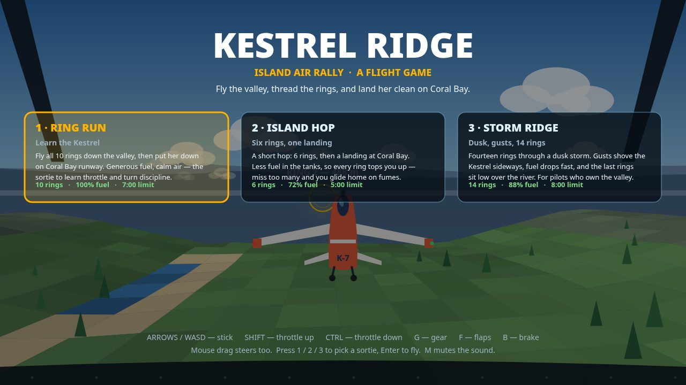

# Kestrel Ridge — Island Air Rally

A complete flight game that runs from static files in any desktop browser,
with no network request. Fly the Kestrel K-7, a single-engine prop tourer,
down a green island valley: thread the glowing rings, mind your fuel and
the stall speed, and put her down clean on Coral Bay runway to finish the
sortie.

## How to play

Serve `game/` with any static server (`node serve.ts`, then open
http://localhost:8080) and fly with keyboard or mouse:

- **Arrows / WASD** — stick: pitch and bank (bank turns the nose)
- **Shift** — throttle up, **Ctrl** — throttle down
- **G** — landing gear, **F** — flaps, **B** — airbrake
- **P / Esc** — pause, **M** — mute, **1 / 2 / 3** — pick a sortie
- **Mouse drag** — steers too; **click a mission card** to fly it

Keep the speed above the stall or the nose drops. Each ring you fly
through scores 100 points and tops up the tanks. Landings count only
when they are gentle, slow, level and on a runway with the gear down —
a belly landing, a hard landing or a fast one ends the sortie. You can
also put down on Ridge Field mid-course to refuel and take off again.

## Three sorties

1. **Ring Run** — 10 rings, generous fuel, calm air. Learn the plane.
2. **Island Hop** — 6 rings, tight fuel. Every ring is a fuel stop.
3. **Storm Ridge** — 14 rings in gusting dusk wind, low over the river.

Every sortie ends the same way: all rings flown, then a landing on
Coral Bay runway B, with a landing bonus and a time bonus against par.

## What is in the frame

- Chase view over a procedural island: valley, river, hills, trees,
  clouds, two runways with centreline and threshold markings
- Lit instruments: airspeed and altitude dials, heading tape,
  artificial horizon, vertical speed, throttle and fuel gauges,
  gear / flaps / brake lamps
- Synthesised sound (WebAudio, no files): engine drone, wind, ring
  chimes, touchdown thud, crash noise
- Title, pause, mission-complete and crash screens, best score kept
  between visits, and a screen-reader status line

## Files

- `game/index.html` — the page; `game/src/` is the game, one job a file:
  `config.js` (tuning), `random.js` (seeded noise), `terrain.js` (the
  island, runways and ring course), `missions.js` (the three sorties),
  `physics.js` (the flight model), `input.js` (keyboard and mouse),
  `audio.js` (synthesised sound), `render.js` (chase camera, terrain,
  aircraft and instruments), `shots.js` (the screenshot autopilot),
  `main.js` (boot, screens and the game loop)
- `main.ts` — hands the entry in: copies `game/` and `screenshots/`
  to `/output` and writes `dossier.json`
- `screenshots/` — four real renders of the game in the browser:
  title, ring run, mission complete, and the dusk storm sortie

## The competition

Built for [Make the best flight game](https://make.fun/c/best-flight-game-20261126-0057)
on make.fun. Original work: the island, the aircraft, the missions and
the sounds are all made for this entry.
